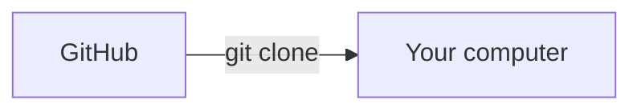
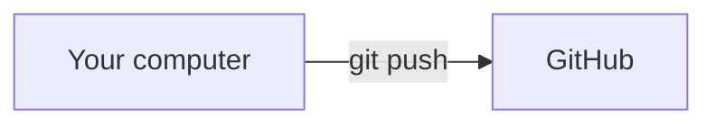
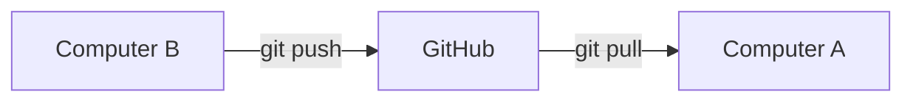

# Week #7: Your Project Has a History — A First Look at Git

[Back to the lesson list](../README.md)

Last week, you built a program that searches for an ARC-solving pipeline. This week, you will learn how engineers keep track of a project as it grows, share their work, and continue from another computer.

**Keep this page open in your browser. Do the exercises on your own computer.** There is no Colab notebook this week, and you do not need to install Python.

Your goal: add a Personal Work Journal to our repository so we can track and share it, then practice working on it from two computers. Allow about two hours, plus any installation time. You can pause after Exercise 6 and do the second-computer visit later.

## Why step outside Colab?

Colab has been a great place to learn: run a little code, see a grid, change something, and try again. It also puts explanations, code, graphs, and results together on one page. We will keep using it when those features help.

Colab supports sharing and notebook revision history. But imagine our ARC project growing into a transformation library, a random-grid generator, a solver, tests, and instructions. Those pieces might live in several files and be edited by several people. We want to record a coordinated change to the whole project, compare versions, and know which changes have been shared.

There is another distinction: sharing a Colab notebook does not share its running computer, installed libraries, or temporary files. Git also does not recreate a running computer; it records the files we choose to track. Setup instructions can be among those files. [Colab's FAQ](https://research.google.com/colaboratory/faq.html) describes what notebook sharing includes.

That brings us to two names you will hear often:

| Name | Its job |
| --- | --- |
| **Git** | Software that records a project's history and exchanges that history between copies. It runs on your computer. |
| **GitHub** | A website that hosts Git repositories and gives people a shared place to browse and exchange work. |

Our project lives in a **repository**, or **repo**, on GitHub. Let's start by exploring the files you can see there.

## Exercise 1: Find the file that is different

Open [our GitHub repository](https://github.com/neurosynthetic/grant-vogt). Choose the **Code** tab if needed.

The file browser shows an ordinary directory tree: a folder can contain files and more folders, which can contain still more files. For example:

```text
grant-vogt/
├── README.md
├── PROPOSAL.md
├── notebooks/
│   ├── week01.ipynb
│   ├── week02a.ipynb
│   ├── ...
│   └── week06b.ipynb
└── lessons/
    └── week07.md       ← this page
```

The three dots stand for more notebook files. A filename's ending, such as `.ipynb`, is its **extension**. `.ipynb` files are notebooks; `.md` files are **Markdown**, ordinary text with simple formatting marks. GitHub turns that text into a readable page.

**Your task:** Use GitHub's file browser to find the one file in our repository whose extension is **neither `.ipynb` nor `.md`**.

Click into folders and look at their contents. When you find the file, open it on GitHub. Write down its path, including the folder it is in, and a sentence describing what it contains. Keep your answers in a temporary note; you will put them in your journal later.

Everything in this exercise happens in your web browser. You do not need to download anything or use a terminal yet.

<details>
<summary>Check your file hunt after trying</summary>

The file is [`notebooks/week01.pdf`](../notebooks/week01.pdf), the Week 1 PDF. A repository can contain different kinds of files, including documents like this one.

</details>

**Checkpoint:** Why would looking only at the repository's top-level file list miss some of its files?

## Exercise 2: Discover the history behind the files

A repository contains files and folders, but it contains much more: **a history of those files**. You can find out how the project reached its current state, including files that were added, modified, or deleted along the way.

Git records that history in units of change called **commits**. One commit might add a notebook, correct several existing files, delete a file that is no longer needed, or combine related changes. Each commit records the project's state after those changes, so Git can compare it with the state before them.

A commit also has an author, a date, and a message describing the change. The author chooses when to make a commit; editing or saving a file does not automatically create one.

### What is a commit ID, and why is it useful?

Git gives each commit an **ID** made of letters and numbers. GitHub often shows a shortened version, such as `3a8fb1e`; the full ID is longer. You do not choose it or need to memorize it.

The ID lets you point to a particular recorded change. Two commits might both have the message “Fix a mistake,” but their IDs distinguish them. You can send your host a link to a specific commit, inspect exactly what it changed, or look at the files as they were at that point. The same commit keeps its ID when copied to another computer, which will help us compare copies later.

As a reference point, on **November 3, 2026**, just before adding this lesson, the repo at commit `3a8fb1e` contained **13 tracked files** and **61 commits on `main`**, the project's main line of development. A tracked file is one Git knows about. Adding this lesson introduces a fourteenth file. Those numbers will grow; later you will measure your own copy.

### Your history hunt

Still using GitHub in your browser, find the **commit that first added the Week 4 notebook**:

1. Open `notebooks/week04.ipynb`.
2. Open its **History** view and look through older entries until you find the addition.
3. Open that commit and inspect its changed files.

Write down the commit's message, date, and short ID. Also note one change you notice in a later Week 4 commit. Add these answers to your temporary note.

<details>
<summary>Hint: finding the history</summary>

Here is the [Week 4 file history](https://github.com/neurosynthetic/grant-vogt/commits/main/notebooks/week04.ipynb). History usually starts with the latest entry. You may need to move to an older page. Opening a commit shows which files changed, not just the current notebook.

</details>

<details>
<summary>Check your detective work after trying</summary>

The notebook was added in [commit 152aaf8](https://github.com/neurosynthetic/grant-vogt/commit/152aaf8), dated October 13, 2026, with message **Week #4**. Later commits revised it. Finding the original addition is different from finding the most recent edit.

</details>

**Checkpoint:** How is this different from keeping files named `solver.py`, `solver-final.py`, and `solver-final-really.py`?

## Setup before the next exercise

In this section, you'll end up needing your GitHub account, Git installed, a terminal, and a plain-text editor. Your host has already given your GitHub account **write access** to this repository. For this lesson, your host has also ensured that direct pushes to `main` are allowed. Other branches and pull requests can wait for a later lesson.

A **terminal** is a window where you type commands for your computer. Use **Terminal** on macOS or **Git Bash** on Windows. The commands below work in both. A Linux terminal works too. Run one line at a time and press Enter. These are terminal commands, not Python code.

Start with:

```bash
git --version
```

**Checkpoint:** Assuming that Git is installed, you'll see a Git version number. If not, use the setup notes below to finish installation and GitHub sign-in on this computer. Get setup working before continuing; installation problems are common, and not a test of your Git skills.

<details>
<summary>Setup notes: installation, editor, and signing in</summary>

- **Windows:** Install [Git for Windows](https://git-scm.com/install/windows), then open its **Git Bash** app.
- **macOS:** In Terminal, `git --version` may offer to install Apple's command-line tools. Follow the prompt, or use the [Git installation instructions](https://git-scm.com/install/mac).
- **Linux:** Use the [Git installation instructions](https://git-scm.com/install/linux).
- **Editor:** VS Code works well if you already have it. Notepad on Windows also works. In TextEdit on macOS, choose **Format → Make Plain Text**. Save the exact filename requested, without an extra `.txt` suffix.

Git needs a way to sign in to GitHub when you push. Being signed in on the website alone is not enough. Configure either Git Credential Manager or GitHub CLI using [GitHub's sign-in setup guide](https://docs.github.com/en/get-started/git-basics/caching-your-github-credentials-in-git). Git for Windows includes Git Credential Manager, which can open a browser for sign-in.

If you choose GitHub CLI, install it from [cli.github.com](https://cli.github.com/), reopen your terminal, and run:

```bash
gh auth login
```

Choose **GitHub.com**, **HTTPS**, and browser login. Say **yes** when asked whether to authenticate Git using your GitHub credentials. `gh` is a separate helper; our everyday commands will still start with `git`.

Use your own GitHub account on each computer. If an HTTPS command asks for a password, your ordinary GitHub account password will not work there; return to the browser-based setup above.

</details>

## Exercise 3: Bring the repository onto your computer

On GitHub, click the green **Code** button and look at its **HTTPS** address. This is the address `git clone` will use. A **clone** is your own local copy, with the project's recorded history. [GitHub's cloning guide](https://docs.github.com/en/repositories/creating-and-managing-repositories/cloning-a-repository) shows the same process.

We will clone the repository directly into your home folder. In your terminal:

```bash
cd ~
git clone https://github.com/neurosynthetic/grant-vogt.git
cd grant-vogt
```

`cd` changes your current directory. `~` means your home folder. `git clone` creates the `grant-vogt` folder there for you. If you already cloned into this location, enter that copy with `cd ~/grant-vogt` instead of cloning again.

Now explore:

```bash
pwd
ls
ls notebooks
git status
git log --oneline -5
```

| Command | What to look for |
| --- | --- |
| `pwd` | Your current folder's full path, ending in `grant-vogt` inside your home folder. |
| `ls` | Familiar files such as `README.md`, and the `notebooks` folder. |
| `ls notebooks` | The lesson notebooks you saw on GitHub. |
| `git status` | `On branch main` and `nothing to commit, working tree clean`. |
| `git log --oneline -5` | The five most recent commits, latest first, with short IDs and messages. |

Your **working tree** is the set of project files you can open and edit. “Clean” means there are no pending changes for Git to record. If a Git display fills the terminal and you cannot type a new command, press `q` to leave that display.

Open the `grant-vogt` folder inside your home folder in Finder or File Explorer. Open `README.md` in your editor. It is a real local file! A notebook might display as structured text in a basic editor; you do not need to run it this week.

Git keeps its history and bookkeeping in a hidden `.git` directory inside this copy. Let Git manage that directory. You can browse the files and read the history without an internet connection after cloning. Downloading a ZIP would give you files, but would leave out this Git history.

### Measure your copy

Run these two measurement commands:

```bash
git ls-files | wc -l
git rev-list --count main
```

The first lists tracked file paths and sends that list through `|` to `wc -l`, which counts lines. It counts files inside subfolders too. The second counts the commits in your `main` history. You do not need to memorize them.

Record both counts and the latest commit ID from `git log` for your journal.

### You now have your own copy

Here is what your `git clone` command just did:



The files and their history are now on your computer too. Compare your latest commit ID with the latest commit on GitHub's `main`. They should match, unless someone has added another commit on GitHub since you cloned.

Your local files are yours to work on. Editing them will not automatically change the files on GitHub. Let's try making a change here first.

**Checkpoint:** If you close GitHub in your browser, are the files still on your computer? Can you still read their history?

## Exercise 4: Create your Personal Work Journal

Stay in the `grant-vogt` folder for the remaining commands on this computer.

First, tell this repository what name and email to put on your commits. Replace the quoted placeholders below. Use the commit email from your [GitHub email settings](https://github.com/settings/emails); you can use GitHub's provided `noreply` address to keep your personal email private.

```bash
git config user.name "Your Name"
git config user.email "YOUR_GITHUB_COMMIT_EMAIL"
```

These settings label your work in this local copy. They do not sign you in or grant write access.

Make a folder for your journal with `mkdir`, which means “make directory”:

```bash
mkdir journal
```

If `journal` already exists, use it. In your editor, create **`journal/week07.md`** inside your local `grant-vogt` folder. If that file already exists from a previous attempt, continue editing it. Start with this text, then fill in your answers:

```markdown
# Personal Work Journal

## File detective
- The file whose extension is neither .ipynb nor .md:
- What it contains:

## History detective
- Week 4 was first added in commit:
- Its message and date:
- One later Week 4 change:
- My starting tracked-file count:
- My starting commit count:
- My starting latest commit ID:

## An idea for my ARC solver
- One transformation I would like to add:
- An input grid where it would help:
- The output I would expect:
```

Markdown's `#` and `##` make headings; `-` starts a bullet. Your ARC idea can be a few sentences or a tiny grid. You are writing a note, not implementing a new solver today.

Save the file in your editor. Then run:

```bash
git status
```

You should see an **untracked** file or folder, often `journal/`. Git has noticed it, but it is not yet in a commit.

**Predict:** Does your journal appear on GitHub yet? Has the number of commits changed?

## Exercise 5: Add your journal to the repository

Your journal is saved on your computer. Now let's add it to the repository so (a) Git can start tracking changes to it, and (b) we can eventually share it with other users of this repository (which we'll do in the next exercise).

Here is how saving, staging, and committing fit together:

| Step | What it does | Why it is separate |
| --- | --- | --- |
| **Save** in your editor | Writes your edits to your computer's files. | You can save as often as you like while experimenting. |
| **Stage** with `git add` | Selects the current version of a file for the next commit. | You choose which changes belong together. |
| **Commit** with `git commit` | Records a project snapshot using those staged changes, with your message. | You create a meaningful checkpoint, even while offline. |

For small changes like this one, it's common to run `git add` and then `git commit` back-to-back. Staging chooses which changes to include; committing records them together. We're pausing between the two here so you can see what each command does.

Stage just your journal, then inspect what will be committed:

```bash
git add journal/week07.md
git status
git diff --staged
```

`git add` works for both new files and later edits. `git status` should now list `journal/week07.md` under **Changes to be committed**.

A **diff** shows what changed. In this diff, lines beginning with `+` are additions; lines beginning with `-` are removals. Those signs are display markers, not extra text inserted into your file.

If you edit the journal again after staging, save it and run `git add journal/week07.md` again. Staging captures the version at that moment; later edits are not silently included.

When the staged content is what you intend, make your first commit:

```bash
git commit -m "Add Personal Work Journal"
git log --oneline -3
git status
```

`-m` supplies the commit message. Write messages that say what changed: **Add Personal Work Journal** is more helpful than **Stuff**.

**Checkpoint:** Your message and a new ID are at the top of the log. The working tree is clean, but your branch may be **ahead of `origin/main` by 1 commit**. That means you have a local commit to share. It is not an error.

Before pushing, refresh the repository on GitHub. The journal is still absent there. **A local commit is a real saved checkpoint, even though GitHub does not have it yet.**

## Exercise 6: Share your first commit

Your commit is saved on your computer. Now you can share it on GitHub with **push**, which sends your local commits to the copy there. That other copy is called a **remote**.

Committing and pushing are separate so you can make checkpoints while you work, even offline, and share them when you are ready.

Run:

```bash
git push origin main
```

`origin` is Git's usual nickname for the remote you cloned from. `main` says which line of development to send. You can see the address behind the nickname with `git remote -v`.

Complete the browser sign-in if prompted. After the push succeeds, refresh GitHub and open **`journal/week07.md`**. Read your note as a rendered page, then find your commit in the history. Its ID should match the one in your terminal.



Your commit is now in both places, with the same message and ID. Pushing shared the commit you already made.

**Checkpoint:** Which step made your journal visible on GitHub? Why wasn't saving or committing enough?

## Exercise 7: Make a second version

Before you edit again, there is one more useful command: **pull**. It brings any commits you are missing from GitHub into your local copy and updates your files. This is how you pick up work shared since your last visit.

First, check your local state:

```bash
git status
```

When the working tree is clean, run:

```bash
git pull --ff-only
```

You will probably see “Already up to date,” since you just pushed your work. That is a successful result: there is nothing else to bring over.

The `--ff-only` option asks Git to stop if the two copies have different changes that need to be combined. See [Git's pull reference](https://git-scm.com/docs/git-pull) for more detail. Continue when the pull succeeds.

Open your journal and add this section, filling in one example:

```markdown
## How I would check my new transformation
- One extra input grid:
- Its expected output:
- What this example checks that my first example did not:
```

Save, then inspect the edit **before staging**:

```bash
git diff
```

Ordinary `git diff` shows edits that have not been staged. `git diff --staged` shows edits selected for the next commit. For a brand-new, untracked file, ordinary `git diff` shows nothing; stage that file to inspect its added lines.

Finish the same cycle:

```bash
git add journal/week07.md
git diff --staged
git commit -m "Describe a test for my ARC transformation"
git push origin main
```

On GitHub, open your journal's **History**. Find both of your commits. Open the newer one and see the lines it added. You now have two versions of the same file without inventing another filename.

**Checkpoint:** Did the file count increase when you edited the journal? Did the commit count increase?

## Exercise 8: Continue on your second computer

Call your first computer **A** and your second computer **B**. Before leaving A, make sure the last push succeeded and `git status` reports a clean working tree. A change left only in an editor or an unpushed commit will not appear on B.

On **B**, repeat the Git installation and sign-in setup if needed. Then:

- **First visit to this project on B:** Follow Exercise 3's `cd` and `git clone` commands. The clone brings the commits you just pushed, including both journal versions.
- **Already have a clone on B:** Open a terminal in that copy, run `git status`, and, if it is clean, run `git pull --ff-only`. You do not clone again each time you sit down.

Inside B's `grant-vogt` folder, set your commit name and email as in Exercise 4. Those local settings and your sign-in are configured separately on each computer.

Run `git log --oneline -3`. Check that the latest ID matches GitHub, then open the journal. You should see the testing section from Exercise 7.

Add this section and answer it on B:

```markdown
## A visit from my second computer
I am editing this on computer B.

One thing that surprised me about Git:
```

Save and publish it:

```bash
git diff
git add journal/week07.md
git diff --staged
git commit -m "Continue Personal Work Journal from my second computer"
git push origin main
```

**Pause and predict:** GitHub now has this commit. Does computer A have it yet?

Return to **A**. Open its journal before pulling: the new section is still missing. In its `grant-vogt` terminal, run:

```bash
git status
git pull --ff-only
git log --oneline -3
```

Reopen the file or let your editor reload it. The section from B should now be there, with the same commit ID you saw on B and GitHub.

You have just moved work between computers without emailing a file or guessing which `final` copy is newer. Here is the route your change took:



GitHub is the shared meeting place for your copies. The commands you run move your work between them.

If B is not available today, leave this exercise for your next visit to it.

## A habit for every work session

**Start:** Enter your project folder, run `git status`, and pull with `git pull --ff-only` when the working tree is clean.

**Work:** Edit and save. Inspect your changes, stage the relevant files, and commit meaningful checkpoints.

**Finish:** Push your commits. Before switching computers, confirm the push succeeded and check for changes you forgot to commit.

Git makes this manageable, but it does not synchronize automatically. It also will not always combine simultaneous edits without help. For this first week, take turns editing, and use the checkpoints above.

<details>
<summary>Optional: What “up to date” means</summary>

`git status` compares with your computer's **last known** view of the remote. “Up to date with `origin/main`” is not a live query to GitHub. Pulling contacts the remote. If you only want to refresh that information without changing your working files, run `git fetch origin`, then `git status`.

</details>

<details>
<summary>If something looks different: a small troubleshooting guide</summary>

| What you see | What to do |
| --- | --- |
| `git: command not found` | Finish installing Git, then reopen the terminal. On Windows, use Git Bash. |
| `not a git repository` | Run `pwd`. Enter your clone with `cd ~/grant-vogt`; Git commands need to run inside it. |
| Clone says the destination already exists | You may already have a clone. Enter it and run `git status`. Keep the existing folder. |
| `Author identity unknown` | Set `user.name` and `user.email` inside this clone, as in Exercise 4. |
| Nothing to commit, but you expected a change | Save the file. Confirm it is inside this clone, then check `git status` and stage the intended path. |
| Push says permission denied, authentication failed, or a repository rule blocked it | Check your GitHub account, accepted invitation, and the host's agreed push setup. Commit identity and permission are separate. |
| Push is rejected because the remote has work you do not have | Someone published another commit. Your local work is still present. Show your host the message so you can combine the histories together. Do not force-push. |
| Pull refuses because of local changes or divergent histories | Keep your work and ask your host to help reconcile the copies. Do not delete files or use a hard reset to make the message disappear. |
| Terminal opens a long, scrolling diff or log | Press `q` to leave the display and return to the prompt. |

An unexpected message is information about the current state. Read it carefully before choosing another command. If you get stuck, save the message for your next check-in.

</details>

## Exercise 9: Explain the trip your work took

Back on A, add your answers to the journal:

1. What is the difference between Git and GitHub?
2. Why are saving, staging, committing, and pushing separate steps?
3. What can you do without an internet connection after cloning?
4. Why can a clean working tree still contain a commit GitHub has not received?
5. If you push from B, what must A do to receive that work?
6. How did commit messages help you find a particular change in your journal's history?

Use the workflow you practiced to commit and push these answers with a descriptive message of your own. Then check the journal on GitHub.

**Finished when:** your journal is on GitHub with several meaningful commits, you can find the original Week 4 commit, and you have completed—or scheduled—the second-computer handoff. Keep the journal's GitHub link and one diff you can explain for your next check-in.

You have contributed to the same repository that has been delivering your lessons. Your journal is now part of the project, where we can track changes and share your work.
